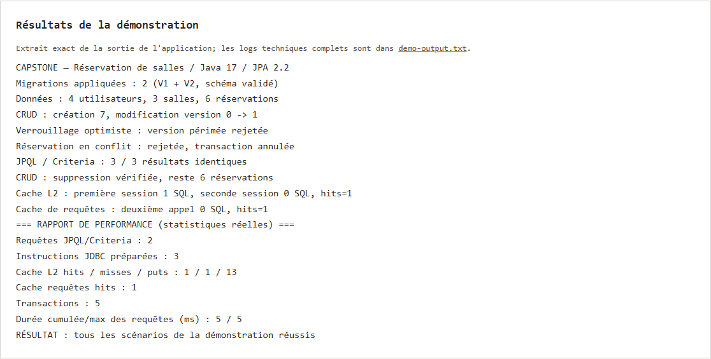
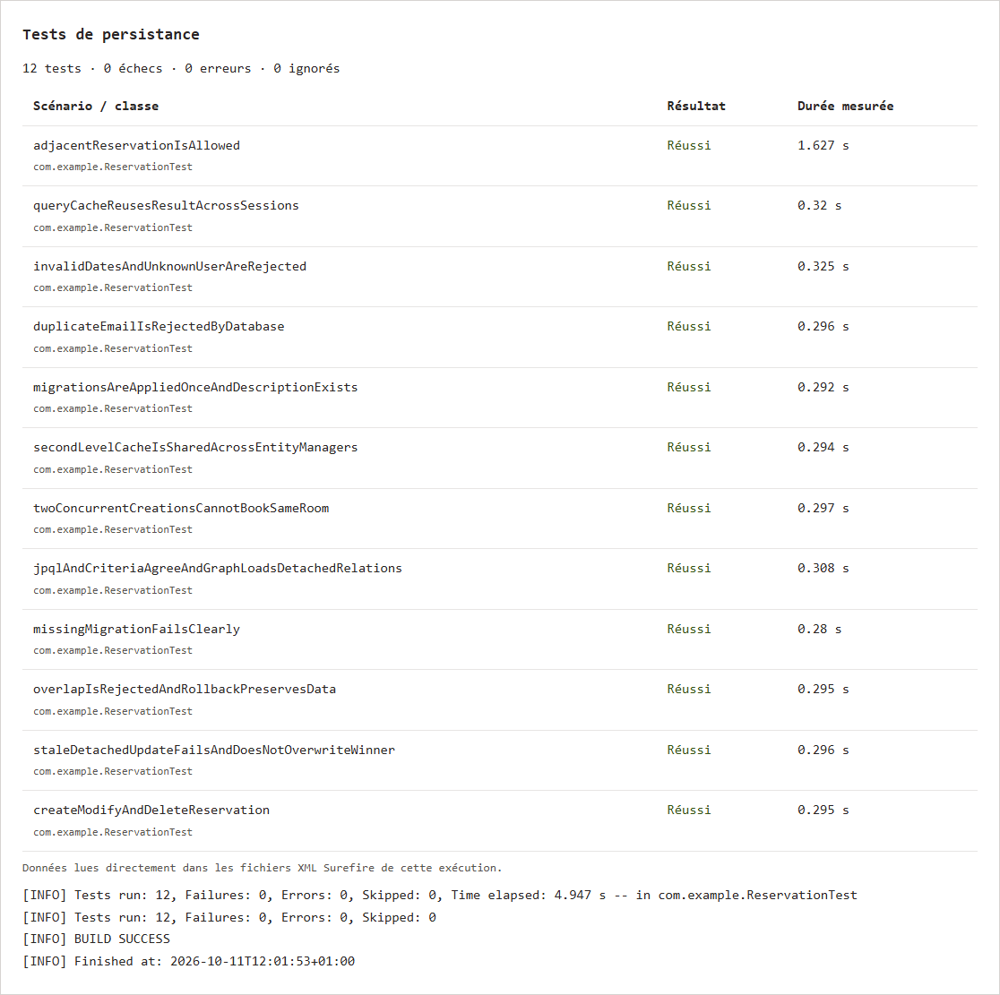

# Capstone — Réservation de salles avec JPA et Hibernate

Ce projet permet de gérer des utilisateurs, des salles et leurs réservations. J'ai utilisé Java 17, JPA et Hibernate avec H2 en mémoire. Les données de démonstration sont créées au lancement.

Les services permettent de créer, modifier, supprimer et rechercher une réservation. Ils vérifient les dates et refusent les créneaux qui se chevauchent dans la même salle. Les réservations qui se suivent sont acceptées. Le projet inclut aussi les transactions, le verrouillage optimiste, des migrations SQL et le cache Ehcache.

## Lancer le projet

Avec Java 17 et Maven :

```bash
mvn clean verify
mvn exec:java
```

## Résultats

Les 12 tests passent, notamment pour les réservations, les conflits, les migrations et le cache. La démo affiche les données et les statistiques Hibernate. Une seconde lecture de salle utilise le cache sans nouvelle requête SQL.

Les sorties d'exécution sont disponibles dans [evidence](evidence/). Les captures ci-dessous montrent le rapport créé à partir de ces résultats.




